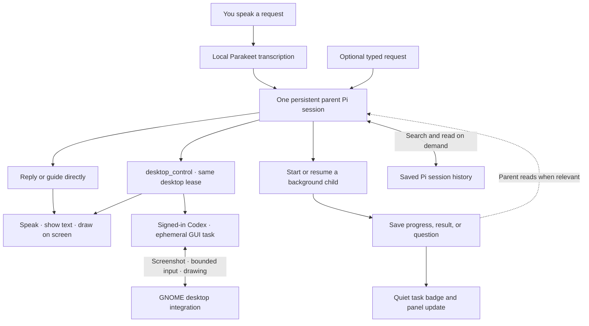

# Friday v0: current request flow

Friday has one foreground parent Pi session. Each user request is a turn in that session. Independent background work gets a separate child Pi session. The host handles process lifecycle, local speech, persistence, and window state; it is not another LLM.

## Session rules

- **Parent:** one current session ID and one active foreground turn. Reuses its Pi process between completed turns to avoid startup overhead. Screen guidance calls observe/draw directly—there is no child round trip. Each new request gets a fresh desktop lease and must observe again.
- **Children:** up to three active or waiting tasks, each with its own Pi process, session file, title, parent ID, and status. Appropriate for independent research, file work, or calculations with a clear deliverable. They use file/shell tools and report progress/results to the registry; only the parent has presentation/session-management tools.
- **New requests:** interrupt an unfinished parent turn, then resume the same parent session. Children continue. This is not a queue of deferred parent requests or completion announcements.
- **Child completion:** ends its process and preserves its session file. A small badge signals an update. The parent receives IDs/titles/statuses in a compact registry on its next turn and can read details. A completion during an existing parent turn does not trigger a second foreground turn.
- **Child questions:** `task_report(needs_input)` stores a question. The parent can read it, ask you, and use `session_actions` to resume that same child. Consequential shell approvals use explicit UI controls; the parent cannot approve on your behalf.
- **History:** the active parent retains Pi's normal conversation context and automatic compaction. Other history is searched/read dynamically via tools, without a separate memory model. Search currently uses case-insensitive text matching, not semantic search. Reads are paginated and omit reasoning/image blocks.
- **Restart:** the parent ID and task registry survive app restarts. Interrupted children are labeled accordingly and require an explicit resume. No invisible restart of old work.

## Parent tools

| Tool                                                 | Purpose                                                              |
| ---------------------------------------------------- | -------------------------------------------------------------------- |
| `session_actions`                                    | Start, update or stop background tasks with one spoken confirmation  |
| `session_start`                                      | Start a child and immediately return its ID                          |
| `session_list`                                       | Inspect saved sessions and statuses                                  |
| `session_read` / `session_search`                    | Fetch a result or relevant saved history                             |
| `session_update` / `session_stop`                    | Resume, redirect, or stop a child                                    |
| `desktop_observe` / `desktop_draw` / `desktop_clear` | Guide directly on the current screen                                 |
| `desktop_control`                                    | Complete a short GUI task with Codex, returning a result or question |
| `speak`                                              | Start short local speech; playback does not block the model          |
| `show_text` / `set_presentation`                     | Show details or expand/collapse Friday                               |

The host enforces tool ownership with a per-process token and an active-turn check. Children have `task_report`, file tools, and shell tools. Shell execution is still under the user's account with the existing consequential-command check, not an OS sandbox.

## Speech and presentation

Only the parent speaks. `speak` starts espeak-ng immediately and a newer utterance replaces it. If the parent answers without calling `speak`, the host reads a short version once, unless speech is disabled; longer details stay visible through `show_text`. Background completions never start speech.

Friday starts in active listening and returns to wake waiting after ten seconds without a request. The local Parakeet detector remains active at rest. “Hey Friday” opens listening, and a command can follow in the same utterance. “Friday stop” is an exact addressed interrupt handled before ordinary request classification. During work, playback, replay startup, or text editing, audio stays live for Stop only; other speech is discarded.

During control, the existing Electron notch stays visible as a compact click-through bar showing Esc-twice instructions; GNOME excludes it from reactive picking and from the operator's screenshots. It returns to its normal status after input is released. Speech updates do not pause the operator. Activating Friday stops control before bringing its window forward. Guidance remains request-driven; only an active control task runs an observation/action loop.

The Codex operator is a blocking parent tool, not another child session. It shares the native permission, validates bounded input against the latest screenshot, and refreshes the screen after each batch. It uses the existing Codex login and an ephemeral thread, disables inherited integrations/environment tools, and returns only summary/progress/timing data to the parent. A question releases input before the parent asks the user. The README documents time limits and the limits of GNOME input shielding.
The notch's Stop cancels speech and all active parent/child tasks, revokes desktop access, clears drawings, and returns an enabled microphone to wake waiting. A submission generation fences requests queued before Stop; capture generations discard stale recognition. Explicit mic-off cancels automatic resumption. Replay holds stop-only listening until its host promise settles, and only one effect restarts follow-up listening.

Outside active computer control, one Electron notch handles foreground states and expands only on hover or keyboard focus. It is hidden only for screenshot capture and restored in a finally block without taking focus. GNOME draws annotations without a separate guidance caption box. Captures preserve existing valid drawings. Guidance starts only after a confirmed nonempty drawing, and ends on clear, Stop, failure, or native expiry/invalidation. Blank optional annotation titles are omitted before validation and native transport.

## Implementation and validation

- `electron/agent-service.ts`: parent/child registry, Pi RPC lifecycle, role-checked runtime tools, interruption and speech ownership.
- `electron/agent-prompts.ts` and `electron/friday-extension.ts`: agent roles and tool definitions.
- `electron/store.ts`: atomic registry persistence and saved Pi history reads.
- `src/FridayPresence.tsx`, `src/App.tsx`: compact surfaces, task updates, optional typing, and voice turns.
- `electron/main/index.ts` and the GNOME extension: compositor placement, local audio, and native overlay integration.

Pi 0.85.1 or newer is required. Turn completion uses `agent_settled`, because Pi may retry or compact after `agent_end`.

Unit tests cover interruption, concurrent children, tool ownership, approvals, history filtering, restart recovery, and speech duplication. `test:native:agent` checks the packaged UI and real-model screen guidance in an isolated GNOME desktop. `test:sessions:agent` checks real Pi delegation, an intervening parent reply, child result retrieval, and history search. Live microphone accuracy and real-world conversational latency still need hands-on evaluation.

## Task selection and microphone interactions

Selecting a task is local UI state, not an agent turn or a conversation switch. The next real submission carries `RequestContext.selectedChildId` through preload and validated IPC. `AgentService.submit` resolves the ID against its own child registry before interrupting the parent, then supplies a fresh bounded snapshot with title, status, summary/question, update time and snapshot time. The parent remains the conversation owner. Child content is data; session_read/search fetch extra details without interrupting work. session_update still interrupts the running child and continues its saved session.

Microphone generations isolate activation, selection and stale transcription. Activating the circle, a task or shortcut restarts capture; old audio cannot become a new instruction. Only request transcription changes the foreground state. Ten seconds with no speech ends immediate listening and clears selection (text editing holds this timer), without stopping children or dismissing guidance, approvals or a text composer. Returning to wake waiting resets the host recognizer too. Explicit mic-off cancels follow-up listening until enabled again. Wake recognition accepts “Hey Friday” with an optional command, or “Friday” alone as a wake-only utterance. Everyday phrases such as “Friday works for me” are ignored. A fresh explicit greeting clears task context even during follow-up listening. It is not an instant wake engine.

The pill and expanded conversation share a 520 px window width and top-center anchor. Background hover uses a right-anchored 400 px panel with a stable circle position, a 450 ms dismissal delay and focus access. Task updates stay quiet and can be acknowledged individually; running and needs-input tasks remain available.

For deterministic rendered regression checks, start Vite on port 5174 and headless Chrome with debugging port 9333, then run `node tests/native/presence.mjs`. The test-only `tests/presence-preview.html` renders the real App with simulated media and IPC; it does not measure real transcription or hardware audio. Native `--ui` checks exercise packaged window placement in isolated GNOME.

Microphone intent is separate from request readiness: work and playback retain the capture device but only addressed Stop is actionable. Voice replies reopen active listening; typed replies return to wake waiting. Closing text input resumes wake waiting. Mic-off cancels resumption. Clearing the task chip changes no audio state. Task context expires after ten idle seconds, while speech in progress is allowed to finish. Local transcription requests serialize across capture generations and discard obsolete queued work.

Run `node tests/native/notch-flow.mjs` for each notch state, `CDP_PORT=9333 node tests/native/presence-speech.mjs` for playback and delayed replay races, and `node tests/native/notch-audio.mjs` for synthetic speech through real local Parakeet and the React app (no physical microphone or hosted agent). These use Vite on 5174 and a headless Chromium debug port 9333. The native harness runs in its own GNOME session, never the user's desktop.

The background circle shows microphone availability and accents tasks needing attention. Question and failure glyphs distinguish those states. The text composer remains outside scrolling content, and tasks collapse while typing. Linux/XWayland window shapes pass clicks through the empty area beside the expanded task circle. `tests/native/presence-review.mjs` holds the regression probes added from the independent Opus review.
