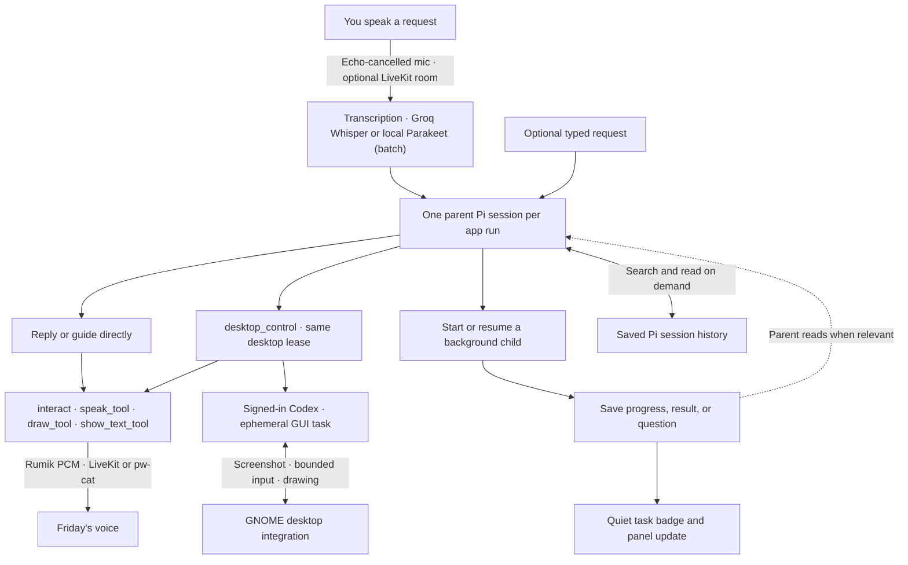

# Friday v0: current request flow

Friday has one foreground parent Pi session. Each user request is a turn in that session. Independent background work gets a separate child Pi session. The host handles process lifecycle, local speech, persistence, and window state; it is not another LLM.

**Camera snapshots** is enabled by default; a saved off preference is preserved. When enabled in Settings, the parent can call `camera_snapshot` when asked to look at the user or physical objects. The host opens the Linux webcam through FFmpeg, captures one JPEG, closes the process, and returns an image block to Pi. The UI shows camera activity until the process closes. Stop, supersession, disabling access, request completion/failure, disconnect, and shutdown cancel pending captures; background children cannot call the tool. Each request permits at most one attempt. Camera photos go to the configured model and remain in Pi history; they may be re-sent on later turns even with camera access off. New conversation removes them from the active context, not saved history. Camera shutdown waits are bounded so a wedged device cannot block Stop, new requests, or Quit; the indicator and capture lock remain until actual close. They do not replace the desktop observation used for drawing.

## Session rules

- **Parent:** one current session ID and one active foreground turn. Reuses its Pi process between completed turns to avoid startup overhead. Screen guidance calls observe/draw directly—there is no child round trip. Each new request gets a fresh desktop lease and must observe again.
- **Children:** up to three active or waiting tasks, each with its own Pi process, session file, title, parent ID, and status. Appropriate for independent research, file work, or calculations with a clear deliverable. They use file/shell tools and report progress/results to the registry; only the parent has presentation/session-management tools.
- **New requests:** interrupt an unfinished parent turn, then resume the same parent session. Children continue. This is not a queue of deferred parent requests or completion announcements.
- **Child completion:** ends its process and preserves its session file. A small badge signals an update. The parent receives IDs/titles/statuses in a compact registry on its next turn and can read details. A completion during an existing parent turn does not trigger a second foreground turn.
- **Child questions:** `task_report(needs_input)` stores a question. The parent can read it, ask you, and use `session_actions` to resume that same child. Consequential shell approvals use explicit UI controls; the parent cannot approve on your behalf.
- **History:** the active parent retains Pi's normal conversation context and automatic compaction. Other history is searched/read dynamically via tools, without a separate memory model. Search currently uses case-insensitive text matching, not semantic search. Reads are paginated and omit reasoning/image blocks.
- **Restart:** every app restart begins a fresh parent Pi session. The task registry and all earlier sessions stay searchable via the session tools. Interrupted children are labeled accordingly and require an explicit resume. No invisible restart of old work.

## Parent tools

| Tool                                | Purpose                                                              |
| ----------------------------------- | -------------------------------------------------------------------- |
| `session_actions`                   | Start, update or stop background tasks with one spoken confirmation  |
| `stop_all`                          | Stop every unfinished background task when the user asks to stop all |
| `session_start`                     | Start a child and immediately return its ID                          |
| `session_list`                      | Inspect saved sessions and statuses                                  |
| `session_read` / `session_search`   | Fetch a result or relevant saved history                             |
| `session_update` / `session_stop`   | Resume, redirect, or stop a child                                    |
| `interact`                          | The only reply path: speak, draw and/or show text in one call        |
| `desktop_observe` / `desktop_clear` | Screenshot for drawing; clear drawings by host-assigned ID           |
| `desktop_control`                   | Complete a short GUI task with Codex, returning a result or question |

The host enforces tool ownership with a per-process token and an active-turn check. Children have `task_report`, file tools, and shell tools. Shell execution is still under the user's account with the existing consequential-command check, not an OS sandbox.

## Speech and presentation

Only the parent replies, and only through `interact`: at most one each of `speak_tool`, `draw_tool` and `show_text_tool`. The host validates the whole call before any effect (a rejection lists every field and runs nothing), then returns per-action status. `parallel` timing starts everything at once. `together` waits (up to 1.5 s) for the first playable audio, then draws and waits for GNOME's paint acknowledgement, then starts speech and text together. If the voice is not ready in time, the visuals go first and speech follows; if the drawing fails, its speech is suppressed. Nothing is rolled back, and an identical retry returns `duplicate`. A newer utterance replaces the current one. There is no automatic speech: final text without an effective `interact` is shown silently. Speech is suppressed, and shown as text, when spoken replies are off, or when a typed request is answered and **Speak replies to typed requests** is off. Background completions never start speech.

Speech status carries its evidence: `dispatch-estimate` (PCM handed to `pw-cat`), `transport` (accepted by LiveKit), `client-observed` (the Friday window measured audible energy while its voice element played unmuted), or `none`. None is an acoustic measurement.

Friday starts in active listening and returns to wake waiting after ten seconds without a request. At rest, frames go only to the on-device keyword spotter in the main process (`electron/wake-word.ts`, 100 ms chunks over IPC) and a 2 s replay buffer; nothing is transcribed. When it fires, the buffer is replayed into the segmenter, and the final transcript is cut at the last “Hey Friday” (`fromWakeWord`); a transcript without the phrase is a false wake and is dropped. A wake with no speech for 3 s lapses. “Hey Friday” opens listening, and a command can follow in the same utterance. Without the model the transcript-based wake matching is the fallback. There is no spoken stop keyword: the parent decides from the request whether to call `stop_all`, which stops every running or waiting child while its own turn continues to confirm.

A voice request keeps the conversation engaged while the parent works and speaks. Recognition is batch (progressive re-decodes of the growing segment give revisable partials before the 850 ms endpoint yields the final transcript) through the configured provider — hosted Groq Whisper when a key is present, otherwise local Parakeet. Groq is billed per request, so it gets no interim re-decodes: talk-over then takes effect at the endpoint rather than mid-sentence. A partial of two or more words, or one addressed to Friday, barges in: `interrupt` stops the voice and unrevealed presentation without cancelling work. The final transcript then replaces the unfinished parent turn — unless it was not addressed to Friday and Friday is busy, in which case TypeSafe's Jev model (`electron/jev-client.ts`, when `TYPESAFE_API_KEY` is set) first decides whether it is meant for Friday; a confident “ignore” leaves the turn running and shows the words dimmed. Corrective openings (“no”, “wait”, “stop”, “actually”) skip that check. The echo guard compares each transcript with what Friday was saying. Timing uses host timestamps on the renderer clock: an entry counts only while it plays or within 1.5 s of its end, and never after 8 s. Words that change meaning (“no”, “not”, “instead”, …) are never discounted as echo. Partials use a looser echo match (half the words) before barging in, and filler sounds never count toward the two words. Finals that are only hesitation sounds, or a lone non-corrective word spoken over Friday, are dropped (`src/voice-turns.ts`). A final that begins within 2.5 s of the previous voice submission, while that request is still thinking (no tool ran, nothing said), is merged with it and resubmitted. The segmenter (`src/progressive-transcription.ts`) learns the room noise floor between turns, holds an endpoint to 1.6 s when the text ends mid-phrase, and discards long wordless noise. For each accepted parent request with audible replies, the host plays one random bundled acknowledgement clip on the lowest-priority `ack` speech lane: the reply, Stop, a new request or barge-in cancels it, and its transcript joins the echo history. Typed requests and text editing pause recognition.

### Optional LiveKit transport

With `LIVEKIT_URL`/`LIVEKIT_API_KEY`/`LIVEKIT_API_SECRET` set, `electron/livekit.ts` (main) joins the room as `friday-voice`. It publishes Rumik PCM (24 kHz, 20 ms frames, backpressured) and subscribes to the `friday-listener` microphone. `src/livekit-link.ts` (renderer) publishes the echo-cancelled `getUserMedia` track and plays Friday's voice through an audio element. It reports routability only while that element and its meter are actually playing.

Main returns the received microphone as 16 kHz frames over IPC. `RemoteCapture` feeds them to the same segmenter, progressive transcription and configured recognizer, so there is one recognizer and no second LLM. Readiness is keyed by the server track SID, and publish/unpublish are serialized, so a superseded publication can neither stay live nor satisfy a newer capture.

Fallbacks:

- Unconfigured or unreachable room, or no microphone within 3 s: direct `PcmCapture`.
- Listener not playing: `pw-cat`.
- Listener lost mid-reply: that reply fails explicitly.
- Stop and barge-in: the sender queue is cleared and the renderer mutes what is already buffered.

The API secret never leaves main. The renderer gets a 10-minute token that may publish only microphone-class audio. Recognition stays local, but microphone and reply audio pass through the configured LiveKit server; a remote server carries that audio.

During control, the existing Electron notch stays visible as a compact click-through bar showing Esc-twice instructions; GNOME excludes it from reactive picking and from the operator's screenshots. It returns to its normal status after input is released. Speech updates do not pause the operator. Activating Friday stops control before bringing its window forward. Guidance remains request-driven; only an active control task runs an observation/action loop.

The Codex operator is a blocking parent tool, not another child session. It shares the native permission, validates bounded input against the latest screenshot, and refreshes the screen after each batch. It uses the existing Codex login and an ephemeral thread, disables inherited integrations/environment tools, and returns only summary/progress/timing data to the parent. A question releases input before the parent asks the user. The README documents time limits and the limits of GNOME input shielding.
The notch's Stop cancels speech and all active parent/child tasks, revokes desktop access, clears drawings, and returns an enabled microphone to wake waiting. A submission generation fences requests queued before Stop; capture generations discard stale recognition. Explicit mic-off cancels automatic resumption. Replay holds stop-only listening until its host promise settles, and only one effect restarts follow-up listening.

Outside active computer control, one Electron notch handles foreground states and expands only on hover or keyboard focus. It is hidden only for screenshot capture and restored in a finally block without taking focus. GNOME draws annotations without a separate guidance caption box. Captures preserve existing valid drawings. Guidance starts only after a confirmed nonempty drawing, and ends on clear, Stop, failure, or native expiry/invalidation. Blank optional annotation titles are omitted before validation and native transport.

## Implementation and validation

- `electron/agent-service.ts`: parent/child registry, Pi RPC lifecycle, role-checked runtime tools, interruption and speech ownership.
- `electron/agent-prompts.ts` and `electron/friday-extension.ts`: agent roles and tool definitions.
- `electron/store.ts`: atomic registry persistence and saved Pi history reads.
- `src/FridayPresence.tsx`, `src/App.tsx`: compact surfaces, task updates, optional typing, and voice turns.
- `electron/interact.ts`, `electron/speech-channel.ts`, `electron/speech-output.ts`: `interact` validation/execution, speech generations and echo history, and playback evidence.
- `electron/livekit.ts`, `src/livekit-link.ts`, `src/echo-guard.ts`: optional LiveKit transport and the echo guard.
- `electron/main/index.ts` and the GNOME extension: compositor placement, local audio, and native overlay integration.

Pi 0.85.1 or newer is required. Turn completion uses `agent_settled`, because Pi may retry or compact after `agent_end`.

Unit tests cover interruption, concurrent children, tool ownership, approvals, history filtering, restart recovery, and speech duplication. `test:native:agent` checks the packaged UI and real-model screen guidance in an isolated GNOME desktop. `test:sessions:agent` checks real Pi delegation, an intervening parent reply, child result retrieval, and history search. Live microphone accuracy and real-world conversational latency still need hands-on evaluation.

## Task selection and microphone interactions

Selecting a task is local UI state, not an agent turn or a conversation switch. The next real submission carries `RequestContext.selectedChildId` through preload and validated IPC. `AgentService.submit` resolves the ID against its own child registry before interrupting the parent, then supplies a fresh bounded snapshot with title, status, summary/question, update time and snapshot time. The parent remains the conversation owner. Child content is data; session_read/search fetch extra details without interrupting work. session_update still interrupts the running child and continues its saved session.

Microphone generations isolate activation, selection and stale transcription. Activating the circle, a task or shortcut restarts capture; old audio cannot become a new instruction. Only request transcription changes the foreground state. Ten seconds with no speech ends immediate listening and clears selection (text editing holds this timer), without stopping children or dismissing guidance, approvals or a text composer. Returning to wake waiting resets the host recognizer too. Explicit mic-off cancels follow-up listening until enabled again. Wake recognition accepts “Hey Friday” with an optional command, or “Friday” alone as a wake-only utterance. Everyday phrases such as “Friday works for me” are ignored. A fresh explicit greeting clears task context even during follow-up listening. It is not an instant wake engine.

The pill and expanded conversation share a 520 px window width and top-center anchor. Background hover uses a right-anchored 400 px panel with a stable circle position, a 450 ms dismissal delay and focus access. Task updates stay quiet and can be acknowledged individually; running and needs-input tasks remain available.

For deterministic rendered regression checks, start Vite on port 5174 and headless Chrome with debugging port 9333, then run `node tests/native/presence.mjs` (`CDP_PORT` and `FRIDAY_PREVIEW_URL` select another pair). The test-only `tests/presence-preview.html` renders the real App with simulated media and IPC; it does not measure real transcription or hardware audio. Native `--ui` checks exercise packaged window placement in isolated GNOME.

Microphone intent is separate from request readiness: work and playback retain the capture device. After a voice request, speech during work or playback can barge in and replace the turn; after a typed request, only speech addressed to Friday is actionable until it completes. Voice replies reopen active listening; typed replies return to wake waiting. Closing text input resumes wake waiting. Mic-off cancels resumption. Clearing the task chip changes no audio state. Task context expires after ten idle seconds, while speech in progress is allowed to finish. Local transcription requests serialize across capture generations and discard obsolete queued work.

Run `node tests/native/notch-flow.mjs` for each notch state, `node tests/native/presence-speech.mjs` for playback and delayed replay races, `node tests/native/interact-flow.mjs` for barge-in, corrections and echo drops, and `node tests/native/notch-audio.mjs` for synthetic speech through real local Parakeet and the React app (no physical microphone or hosted agent). These use Vite on 5174 and a headless Chromium debug port 9333. With a local LiveKit dev server and `pnpm desktop:build`, `node tests/native/livekit-transport.mjs` checks compiled main transport with an rtc-node listener. `node tests/native/livekit-renderer.mjs` (muted Chromium on 9335) checks the real browser SDK path. Both use synthetic tones, and their timings are transport-level only. The native harness runs in its own GNOME session, never the user's desktop.

The background circle shows microphone availability and accents tasks needing attention. Question and failure glyphs distinguish those states. The text composer remains outside scrolling content, and tasks collapse while typing. Linux/XWayland window shapes pass clicks through the empty area beside the expanded task circle. `tests/native/presence-review.mjs` holds the regression probes added from the independent Opus review.
