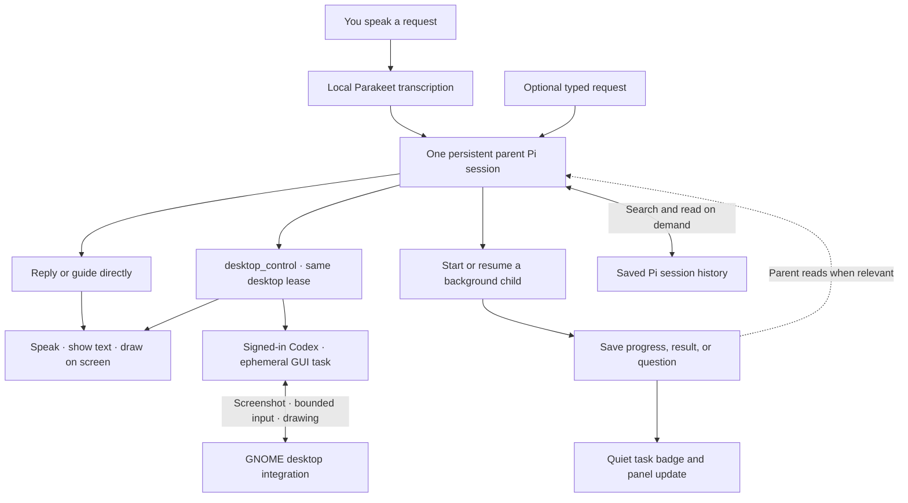

# Friday v0: current request flow

Friday has one foreground parent Pi session. Each user request is a turn in that session. Independent background work gets a separate child Pi session. The host handles process lifecycle, local speech, persistence, and window state; it is not another LLM.

## Session rules

- **Parent:** one current session ID and one active foreground turn. Reuses its Pi process between completed turns to avoid startup overhead. Screen guidance calls observe/draw directly—there is no child round trip. Each new request gets a fresh desktop lease and must observe again.
- **Children:** up to three active or waiting tasks, each with its own Pi process, session file, title, parent ID, and status. Appropriate for independent research, file work, or calculations with a clear deliverable. They use file/shell tools and report progress/results to the registry; only the parent has presentation/session-management tools.
- **New requests:** interrupt an unfinished parent turn, then resume the same parent session. Children continue. This is not a queue of deferred parent requests or completion announcements.
- **Child completion:** ends its process and preserves its session file. A small badge signals an update. The parent receives IDs/titles/statuses in a compact registry on its next turn and can read details. A completion during an existing parent turn does not trigger a second foreground turn.
- **Child questions:** `task_report(needs_input)` stores a question. The parent can read it, ask you, and use `session_update` to resume that same child. Consequential shell approvals use explicit UI controls; the parent cannot approve on your behalf.
- **History:** the active parent retains Pi's normal conversation context and automatic compaction. Other history is searched/read dynamically via tools, without a separate memory model. Search currently uses case-insensitive text matching, not semantic search. Reads are paginated and omit reasoning/image blocks.
- **Restart:** the parent ID and task registry survive app restarts. Interrupted children are labeled accordingly and require an explicit resume. No invisible restart of old work.

## Parent tools

| Tool                                                 | Purpose                                                              |
| ---------------------------------------------------- | -------------------------------------------------------------------- |
| `session_start`                                      | Start a child and immediately return its ID                          |
| `session_list`                                       | Inspect saved sessions and statuses                                  |
| `session_read` / `session_search`                    | Fetch a result or relevant saved history                             |
| `session_update` / `session_stop`                    | Resume, redirect, or stop a child                                    |
| `desktop_observe` / `desktop_draw` / `desktop_clear` | Guide directly on the current screen                                 |
| `desktop_control`                                    | Complete a short GUI task with Codex, returning a result or question |
| `speak`                                              | Start short local speech; playback does not block the model          |
| `show_text` / `set_presentation`                     | Show details or expand/collapse Friday                               |

The host enforces tool ownership with a per-process token and an active-turn check. Children have `task_report`, file tools, and shell tools. Shell execution is still under the user's account with the existing consequential-command check, not an OS sandbox.

## Speech and presentation

Only the parent speaks. `speak` starts espeak-ng immediately and a newer utterance replaces it. If the parent answers without calling `speak`, the host reads a short version once, unless speech is disabled; longer details stay visible through `show_text`. Background completions never start speech.

Clicking the microphone or the talk shortcut stops speech and opens listening; the parent's current turn is interrupted when the new request is submitted. Speaking over TTS alone does not interrupt it, and stopping the foreground leaves children running. Wake recognition uses Parakeet transcription, not a dedicated wake detector. The README describes the companion surfaces.

During guidance, the Electron surface is minimized and GNOME shows a native bar with Reply/Stop until the drawing clears. During control, a non-clickable bottom banner replaces it, with progress and Esc-twice instructions. Speech updates do not pause the operator. Activating Friday stops control before bringing its window forward. Guidance remains request-driven; only an active control task runs an observation/action loop.

The Codex operator is a blocking parent tool, not another child session. It shares the native permission, validates bounded input against the latest screenshot, and refreshes the screen after each batch. It uses the existing Codex login and an ephemeral thread, disables inherited integrations/environment tools, and returns only summary/progress/timing data to the parent. A question releases input before the parent asks the user. The README documents time limits and the limits of GNOME input shielding.

## Implementation and validation

- `electron/agent-service.ts`: parent/child registry, Pi RPC lifecycle, role-checked runtime tools, interruption and speech ownership.
- `electron/agent-prompts.ts` and `electron/friday-extension.ts`: agent roles and tool definitions.
- `electron/store.ts`: atomic registry persistence and saved Pi history reads.
- `src/FridayPresence.tsx`, `src/App.tsx`: compact surfaces, task updates, optional typing, and voice turns.
- `electron/main/index.ts` and the GNOME extension: compositor placement, local audio, and native overlay integration.

Pi 0.85.1 or newer is required. Turn completion uses `agent_settled`, because Pi may retry or compact after `agent_end`.

Unit tests cover interruption, concurrent children, tool ownership, approvals, history filtering, restart recovery, and speech duplication. `test:native:agent` checks the packaged UI and real-model screen guidance in an isolated GNOME desktop. `test:sessions:agent` checks real Pi delegation, an intervening parent reply, child result retrieval, and history search. Live microphone accuracy and real-world conversational latency still need hands-on evaluation.
